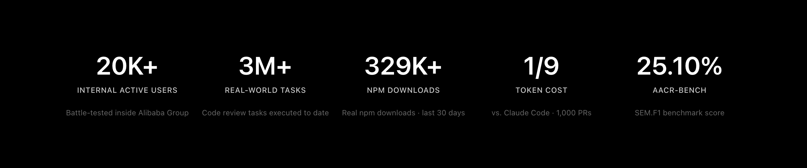

<div align="center">
  <a href="https://open-codereview.ai">
    
  </a>
  <h1>OpenCodeReview</h1>
</div>

<p align="center">
  <a href="https://trendshift.io/repositories/41087?utm_source=repository-badge&amp;utm_medium=badge&amp;utm_campaign=badge-repository-41087" target="_blank" rel="noopener noreferrer">
    
  </a>
</p>
<p align="center">
  <a href="https://trendshift.io/repositories/41087" target="_blank">
    
  </a>
  <a href="https://trendshift.io/repositories/41087" target="_blank">
    
  </a>
</p>
<p align="center">
  <a href="https://www.npmjs.com/package/@smallfishworld/open-code-review-svn"></a>
  <a href="https://github.com/smallfishworld/open-code-review-svn/actions/workflows/svn-self-test.yml"></a>
  <a href="https://github.com/alibaba/open-code-review/blob/main/LICENSE"></a>
  <a href="https://deepwiki.com/alibaba/open-code-review"></a>
  <a href="https://www.bestpractices.dev/projects/13328"></a>
</p>
<p align="center">
  <a href="#supported-platforms"></a>
  <a href="#supported-platforms"></a>
  <a href="#supported-platforms"></a>
  <a href="#supported-agents"></a>
  <a href="#supported-agents"></a>
  <a href="#supported-agents"></a>
  <a href="#supported-agents"></a>
</p>
<p align="center">
  English | <a href="docs/i18n/README.zh-CN.md">简体中文</a> | <a href="docs/i18n/README.ja-JP.md">日本語</a> | <a href="docs/i18n/README.ko-KR.md">한국어</a> | <a href="docs/i18n/README.ru-RU.md">Русский</a>
</p>

---

## About this SVN-enabled fork

This repository, [smallfishworld/open-code-review-svn](https://github.com/smallfishworld/open-code-review-svn), is an **SVN-enabled fork** of the upstream [Alibaba OpenCodeReview](https://github.com/alibaba/open-code-review) project. It keeps the upstream Git review features while adding Subversion (SVN) working-copy and historical revision reviews.

**Current fork release:** [v1.12.13-svn.2](https://github.com/smallfishworld/open-code-review-svn/releases/tag/v1.12.13-svn.2) · [npm package](https://www.npmjs.com/package/@smallfishworld/open-code-review-svn) · [SVN CLI reference](pages/src/content/docs/en/cli-reference.md)

## What is Open Code Review?

Open Code Review is an AI-powered code review CLI tool. It originated as Alibaba Group's internal official AI code review assistant — over the past two years, it has served tens of thousands of developers and identified millions of code defects. After thorough validation at massive scale, we incubated it into an open source project for the community. Simply configure a model endpoint to get started.

It reads Git or SVN diffs, sends changed files to a configurable LLM via an agent with tool-use capabilities, and generates structured review comments with line-level precision. The agent can read full file contents, search the codebase, inspect other changed files for context, and produce deep reviews — not just surface-level diff feedback. Beyond diff review, `ocr scan` reviews entire files for auditing unfamiliar codebases or directories that have no meaningful diff.

Visit the [official website](https://open-codereview.ai) for more details.



## Benchmark

> Compared to general-purpose agents (Claude Code), Open Code Review achieves significantly higher **Precision** and **F1** with the same underlying model, while consuming only **~1/9 of the tokens** and completing reviews faster. Note that its Recall is lower than general-purpose agents — a deliberate trade-off favoring precision over noise.

A real-world code review benchmark built from **50** popular open-source repositories, **200** real Pull Requests, and **10** programming languages — cross-validated by 80+ senior engineers (**1,505** annotated ground-truth issues).

<a href="https://huggingface.co/datasets/Alibaba-Aone/aacr-bench"> Explore the AACR-Bench dataset on Hugging Face</a>.

| Metric | What it measures | Why it matters |
|--------|-----------------|----------------|
| **F1** | Harmonic mean of precision and recall | Best single number for overall review quality |
| **Precision** | Proportion of reported issues that are real defects | Higher = fewer false alarms to triage |
| **Recall** | Proportion of real defects that are found | Higher = fewer issues slip through review |
| **Avg Time** | Wall-clock time per review | Matters for CI pipeline latency |
| **Avg Token** | Total tokens consumed per review | Directly impacts API cost |


## Why Open Code Review?

### The Problem with General-Purpose Agents

If you've used general-purpose agents like Claude Code with Skills for code review, you've likely encountered these pain points:

- **Incomplete coverage** — On larger changesets, agents tend to "cut corners," selectively reviewing only some files and missing others.
- **Position drift** — Reported issues frequently don't match the actual code location, with line numbers or file references drifting off target.
- **Unstable quality** — Natural-language-driven Skills are hard to debug, and review quality fluctuates significantly with minor prompt variations.

The root cause: a purely language-driven architecture lacks hard constraints on the review process.

### Core Design: Deterministic Engineering × Agent Hybrid

Open Code Review's core philosophy is to combine deterministic engineering with an agent, each handling what it does best.

**Deterministic Engineering — Hard Constraints**

For review steps that *must not go wrong*, engineering logic — not the language model — guarantees correctness:

- **Precise file selection** — Determines exactly which files need review and which should be filtered, ensuring no important change is missed.
- **Smart file bundling** — Groups related files into a single review unit (e.g., `message_en.properties` and `message_zh.properties` are bundled together). Each bundle runs as a sub-agent with isolated context — a divide-and-conquer strategy that stays stable on very large changesets and naturally supports concurrent review.
- **Fine-grained rule matching** — Matches review rules to each file's characteristics, keeping the model's attention sharply focused and eliminating information noise at the source. Compared to purely language-driven rule guidance, template-engine-based rule matching is more stable and predictable.
- **External positioning and reflection modules** — Independent comment-positioning and comment-reflection modules systematically improve both the location accuracy and content accuracy of AI feedback.

**Agent — Dynamic Decision-Making**

The agent's strengths are concentrated where they matter most — dynamic decisions and dynamic context retrieval:

- **Scenario-tuned prompts** — Prompt templates deeply optimized for code review, improving effectiveness while reducing token consumption.
- **Scenario-tuned toolset** — Distilled from deep analysis of tool-call traces in large-scale production data — including call frequency distributions, per-tool repetition rates, and the impact of new tools on the overall call chain — resulting in a purpose-built toolset that is more stable and predictable for code review than a generic agent toolkit.

## How to Use

### Prerequisites

- **Git >= 2.41** — Required for Git workspace, range, and commit reviews.
- **SVN >= 1.9** — Required for SVN working-copy and historical revision reviews (Git is not needed for SVN diff generation).

### CLI

#### Install

```bash
# Install the tested fork release
npm install -g @smallfishworld/open-code-review-svn@1.12.13-svn.2

# Or track the moving SVN release tag
npm install -g @smallfishworld/open-code-review-svn@svn
```

After installation, the `ocr` command is available globally.

For offline installation, download the matching Windows, macOS, or Linux binary (and `sha256sum.txt`) from the [fork's GitHub Release](https://github.com/smallfishworld/open-code-review-svn/releases/tag/v1.12.13-svn.2). General upstream installation documentation is available at [Installation](https://open-codereview.ai/docs/installation); its upstream npm package is **not** this SVN-enabled fork.

**Linux x86_64 fully offline archive:** [linux-x86-64-offline.tar.gz](https://github.com/smallfishworld/open-code-review-svn/releases/download/v1.12.13-svn.2/linux-x86-64-offline.tar.gz) ([SHA-256](https://github.com/smallfishworld/open-code-review-svn/releases/download/v1.12.13-svn.2/linux-x86-64-offline.tar.gz.sha256)). Download on an internet-connected computer, transfer both files to your offline Linux machine, then run:

```bash
sha256sum -c linux-x86-64-offline.tar.gz.sha256
tar -xzf linux-x86-64-offline.tar.gz
cd linux-x86-64-offline
sha256sum -c SHA256SUMS
./ocr --version                 # run directly, no installation required
./install.sh                   # optional: install to ~/.local/bin
```

The archive is self-contained for installation (no Go, Node.js, npm, or download required). SVN review requires Subversion installed and AI-powered review needs a reachable model endpoint (including an intranet endpoint).

#### Quick Start

**1. Configure LLM**

You must configure an LLM before reviewing code, unless you use [Delegation Mode](https://open-codereview.ai/docs/delegate).

```bash
ocr config provider          # Select a built-in provider or add a custom one
ocr config model             # Pick a model for the active provider
```


The interactive UI guides you through provider selection, API key entry, and model configuration, then automatically tests connectivity.

For CLI setup, environment variables, custom providers, and other advanced configuration, see [Configuration](https://open-codereview.ai/docs/configuration).

**2. Review**

```bash
cd your-project

# Git workspace mode — review staged, unstaged, and untracked changes
ocr review

# SVN working copy — review versioned, uncommitted changes
ocr review --repo /path/to/svn-working-copy

# SVN single revision (r1234 vs r1233)
ocr review --repo /path/to/svn-working-copy --commit 1234

# SVN revision range (r1200 vs r1234 snapshots)
ocr review --repo /path/to/svn-working-copy --from 1200 --to 1234

# SVN preview (no LLM call)
ocr review --repo /path/to/svn-working-copy --commit 1234 --preview

# Git branch range — compare from merge-base to feature-branch
ocr review --from main --to feature-branch

# Git single commit
ocr review --commit abc123

# Resume an interrupted range or commit review
ocr session list
ocr review --from main --to feature-branch --resume <session-id>

# Full-file scan — review whole files instead of a diff (no git history needed)
ocr scan                          # scan the entire repository
ocr scan --path internal/agent    # scan a directory or specific files
ocr scan --resume <session-id>   # resume an interrupted full-file scan

# Save results to a file (recommended for AI host agents)
ocr review --format json --output result.json

# Delegation mode — let your AI coding agent perform the review itself
# OCR handles file selection and rule resolution; no LLM configuration needed
ocr delegate preview
ocr delegate rule src/main.go src/handler.go
```

### SVN Review: Working Copy, Single Revision, and Revision Range

The fork automatically detects SVN working copies and resolves their root (including when invoked from a nested directory). The **same `ocr review` command** supports three SVN input modes:

| Mode | Example | What is reviewed |
|------|---------|------------------|
| Uncommitted working copy | `ocr review` | Versioned local changes reported by `svn status --xml` and `svn diff` |
| Single revision | `ocr review --commit 1234` | Changes introduced by SVN **r1234**, compared with r1233 |
| Revision range | `ocr review --from 1200 --to 1234` | Cumulative difference between repository snapshots at **r1200** and **r1234** |

```bash
cd /path/to/svn-working-copy

# Review changes before committing (including scheduled adds and deletes)
svn status
ocr review --preview                  # list candidate files without calling an LLM
ocr review

# Review a historical SVN revision
ocr review --commit 1234 --preview
ocr review --commit 1234

# Review a revision range
ocr review --from 1200 --to 1234 --preview --format json
ocr review --from 1200 --to 1234

# Explicit working-copy path also works
ocr review --repo /path/to/svn-working-copy --commit 1234
```

**Behavior and limitations**

- SVN revisions must be **positive decimal numbers without an `r` prefix**. Range mode requires both `--from` and `--to`, with `--from` less than `--to`. Do not combine `--commit` with range flags.
- Historical review uses `svn diff` and reads file contents at the requested SVN revision with `svn cat`, so **uncommitted local edits do not change the historical snapshot being reviewed**.
- In working-copy mode, unversioned (`?`) files are skipped until `svn add <path>` is run. Scheduled additions, deletions, filenames with spaces, and UTF-8 filenames are covered by SVN tests. Binary changes are detected but are not treated as reviewable source text.
- `--preview` runs file selection without invoking an LLM; use it to verify scope before spending model tokens.
- In SVN review, agent `code_search` and `file_find` use the SVN versioned file inventory instead of `git grep` / `git ls-files`. Workspace searches use the local files; historical searches read the selected revision. SVN regex searches use Go RE2 syntax (PCRE-only constructs are not supported).
- Git-style `--resume` of historical reviews is **not a supported SVN workflow**. Git `--commit` and `--from`/`--to` continue to accept Git refs with their original Git semantics.

See the [fork's source-level CLI reference](pages/src/content/docs/en/cli-reference.md) and [v1.12.13-svn.2 binaries](https://github.com/smallfishworld/open-code-review-svn/releases/tag/v1.12.13-svn.2).

## Documentation

Full documentation lives at **[open-codereview.ai/docs](https://open-codereview.ai/docs)**:

- [Quickstart](https://open-codereview.ai/docs/quickstart) — install and run your first review
- [Installation](https://open-codereview.ai/docs/installation) — all platforms and package managers
- [CLI Reference](https://open-codereview.ai/docs/cli-reference) — every command and flag
- [Review Rules](https://open-codereview.ai/docs/review-rules) — customize review rules with path filtering and targeting
- [Configuration](https://open-codereview.ai/docs/configuration) — config keys and environment variables
- [MCP Server](https://open-codereview.ai/docs/mcp) — extend the review agent with external tools
- Coding Agent Integrations — choose the platform you use
  - [Claude Code](plugins/open-code-review/README.md#claude-code) — install a plugin with review slash commands
  - [Codex](plugins/open-code-review/README.md#codex) — install a plugin with callable review skills
  - [Cursor](plugins/open-code-review/README.md#cursor) — install a plugin with portable review skills
  - [Kimi Code](plugins/open-code-review/README.md#kimi-code) — install a plugin with review slash commands and skills
  - [OpenCode](plugins/open-code-review/opencode/README.md) — install native review tools and slash commands
  - [QCA Forward](plugins/open-code-review/qca/README.md) — run delegation mode with the QCA host model and a ready-to-publish template
  - [Skill-compatible agents](https://open-codereview.ai/docs/agent-skill) — install the portable agent skill
- Review Execution Modes — after integration, choose which LLM performs the review
  - [Default (OCR-managed)](https://open-codereview.ai/docs/configuration) — OCR runs the review using its configured LLM
  - [Delegation Mode](https://open-codereview.ai/docs/delegate) — your coding agent runs the review using its own LLM; no OCR API key required
- [CI/CD Integration](https://open-codereview.ai/docs/cicd) — GitHub Actions, GitLab CI, GitFlic CI, and Gerrit integration
- [Session Viewer](https://open-codereview.ai/docs/viewer) — browse and replay review sessions in browser, mark comments as fixed or ignored and hide them while you work through the findings
- [Telemetry](https://open-codereview.ai/docs/telemetry) — OpenTelemetry integration for observability
- [FAQ](https://open-codereview.ai/docs/faq) — common questions and troubleshooting

## Contributing

This project exists thanks to all the people who contribute. See [CONTRIBUTING.md](CONTRIBUTING.md) for development setup, coding guidelines, and how to submit pull requests.

<a href="https://github.com/alibaba/open-code-review/graphs/contributors">
  
</a>

## License

[Apache-2.0](LICENSE) — Copyright 2026 Alibaba
