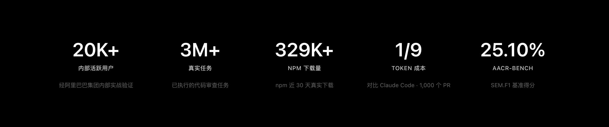

<div align="center">
  <a href="https://open-codereview.ai">
    
  </a>
  <h1>OpenCodeReview</h1>
</div>

<p align="center">
  <a href="https://trendshift.io/repositories/41087?utm_source=repository-badge&amp;utm_medium=badge&amp;utm_campaign=badge-repository-41087" target="_blank" rel="noopener noreferrer">
    
  </a>
</p>
<p align="center">
  <a href="https://trendshift.io/repositories/41087" target="_blank">
    
  </a>
  <a href="https://trendshift.io/repositories/41087" target="_blank">
    
  </a>
</p>
<p align="center">
  <a href="https://www.npmjs.com/package/@smallfishworld/open-code-review-svn"></a>
  <a href="https://github.com/smallfishworld/open-code-review-svn/actions/workflows/svn-self-test.yml"></a>
  <a href="https://github.com/alibaba/open-code-review/blob/main/LICENSE"></a>
  <a href="https://deepwiki.com/alibaba/open-code-review"></a>
  <a href="https://www.bestpractices.dev/projects/13328"></a>
</p>
<p align="center">
  <a href="#supported-platforms"></a>
  <a href="#supported-platforms"></a>
  <a href="#supported-platforms"></a>
  <a href="#supported-agents"></a>
  <a href="#supported-agents"></a>
  <a href="#supported-agents"></a>
  <a href="#supported-agents"></a>
</p>
<p align="center">
  <a href="../../README.md">English</a> | 简体中文 | <a href="README.ja-JP.md">日本語</a> | <a href="README.ko-KR.md">한국어</a> | <a href="README.ru-RU.md">Русский</a>
</p>

---

## 关于 SVN 增强版

本仓库 [smallfishworld/open-code-review-svn](https://github.com/smallfishworld/open-code-review-svn) 基于阿里巴巴官方 [OpenCodeReview](https://github.com/alibaba/open-code-review) 维护，在保留上游 Git 代码审查能力的同时，新增 **SVN 工作副本审查、指定版本号审查以及版本区间审查**。

**当前版本：** [v1.12.13-svn.2](https://github.com/smallfishworld/open-code-review-svn/releases/tag/v1.12.13-svn.2) · [npm 软件包](https://www.npmjs.com/package/@smallfishworld/open-code-review-svn) · [SVN CLI 参数参考](../../pages/src/content/docs/zh/cli-reference.md)

## Open Code Review 是什么？

Open Code Review 是一款 AI 驱动的代码审查 CLI 工具。它的前身是阿里集团内部官方 AI 代码审查助手，过去两年在内部服务了数万开发者，识别了数百万个代码缺陷。经过大规模充分验证后，我们将其孵化为开源项目，对社区开放。只需配置一个模型端点即可使用。

它读取 Git 或 SVN diff，通过具备工具调用能力的 Agent 将变更文件发送至可配置的 LLM，生成具有行级精度的结构化审查意见。Agent 可以读取完整文件内容、搜索代码库、检查其他变更文件以获取上下文，从而进行深度审查——而非仅停留在表面的 diff 反馈。除了 diff 审查，`ocr scan` 可以审查整个文件，适用于审计不熟悉的代码库或没有有意义 diff 的目录。

访问[官方网站](https://open-codereview.ai)了解更多信息。



## 基准测试

> 相比通用 Agent（Claude Code），Open Code Review 在相同底层模型下取得了显著更高的 **准确率（Precision）** 与 **F1 综合得分**，同时仅消耗 **约 1/9 的 token**、审查更快。但召回率（Recall）低于通用 Agent——这是以精准度换取低噪声的设计取舍。

基于真实场景的代码审查基准测试，从 **50** 个热门开源仓库中精选 **200** 个真实的 Pull Request，覆盖 **10** 种编程语言——由 80+ 位资深工程师交叉标注验证（共 **1,505** 个标注缺陷）。

<a href="https://huggingface.co/datasets/Alibaba-Aone/aacr-bench"> 在 Hugging Face 上探索 AACR-Bench 数据集</a>。

| 指标 | 含义 | 为什么重要 |
|------|------|-----------|
| **F1** | 准确率与召回率的调和均值 | 综合衡量审查质量的最佳单一指标 |
| **准确率 (Precision)** | 报告的问题中真正有效的比例 | 越高 = 误报越少，减少人工确认成本 |
| **召回率 (Recall)** | 真实缺陷中被发现的比例 | 越高 = 漏报越少，更多问题不会遗漏 |
| **平均耗时 (Avg Time)** | 每次审查的实际耗时 | 决定 CI 流水线的等待时间 |
| **平均 Token (Avg Token)** | 每次审查消耗的总 token 数 | 直接影响 API 使用成本 |


## 为什么选择 Open Code Review？

### 通用 Agent 的局限

如果你深度用过 Claude Code 等通用 Agent + Skills 方案做代码审查，可能对以下问题深有同感：

- **覆盖不全** —— 变更较大时，Agent 倾向于"偷懒"，选择性地审查部分文件，导致遗漏。
- **位置漂移** —— 报告的问题与实际代码位置常常对不上，出现行号或文件偏移。
- **效果不稳定** —— 基于自然语言驱动的 Skills 难以调试，审查质量因提示词的细微差异而大幅波动。

这些问题的根源在于：纯语言驱动的架构缺乏对审查流程的强约束。

### 核心设计：确定性工程 × Agent 混合驱动

Open Code Review 的核心设计理念是将确定性工程与 Agent 结合，各司其职。

**确定性工程——负责强约束**

对代码审查场景中"不能出错"的环节，由工程逻辑而非语言模型来保证：

- **精准的文件筛选** —— 明确哪些文件需要审查、哪些应当过滤，确保真正重要的改动一个不漏。
- **智能的文件打包** —— 将关联文件归并为同一审查单元（例如 `message_en.properties` 与 `message_zh.properties` 会被打包在一起）。每个包会作为 sub-agent 进行任务，它们之间的上下文是隔离的——这一分治策略在超大变更场景下表现更为稳定，同时天然支持并发审查。
- **精细化规则匹配** —— 针对不同文件的特征，匹配对应的审查规则，确保模型的注意力足够聚焦，从源头规避信息噪声的干扰。相比纯语言驱动的规则引导，基于模板引擎的规则匹配行为更稳定、结果更可预期。
- **外挂的定位与反思组件** —— 独立的评论定位模块与评论反思模块，系统性地提升 AI 反馈的位置准确性与内容准确性。

**Agent——负责动态决策**

将 Agent 的优势集中发挥在它真正擅长的地方——动态决策、动态召回上下文：

- **场景化提示词调优** —— 针对代码审查场景深度优化提示词模板，在提升效果的同时有效降低 Token 消耗。
- **场景化工具集沉淀** —— 基于对大量线上数据中工具调用轨迹的深入分析，包括不同工具的调用频率分布、单一工具的重复调用率、新增工具对整体调用链路的影响等多维度分析，从而对通用 Agent 工具集进行取舍与拆分，最终沉淀出一套在代码审查场景下效果更稳定、行为更可预期的专属工具集。

## 如何使用

### 前置条件

- **Git >= 2.41** — Git 工作区、单次提交和版本区间审查需要 Git。
- **SVN >= 1.9** — SVN 工作副本及历史版本审查需要 Subversion；获取 SVN diff 不依赖 Git。

### CLI

#### 安装

```bash
# 安装经过测试的 SVN 增强版本
npm install -g @smallfishworld/open-code-review-svn@1.12.13-svn.2

# 或跟随 svn 发布标签更新
npm install -g @smallfishworld/open-code-review-svn@svn
```

安装后，`ocr` 命令即可全局使用。

如果需要离线安装，请到 [本 fork 的 GitHub Release](https://github.com/smallfishworld/open-code-review-svn/releases/tag/v1.12.13-svn.2) 下载对应平台的 Windows、macOS 或 Linux 可执行文件及 `sha256sum.txt` 校验文件。官方[安装指南](https://open-codereview.ai/docs/installation)介绍的是上游软件，**上游 npm 包不包含本 fork 的 SVN 功能**。

**Linux x86_64 专用离线包：** [linux-x86-64-offline.tar.gz](https://github.com/smallfishworld/open-code-review-svn/releases/download/v1.12.13-svn.2/linux-x86-64-offline.tar.gz)（[SHA-256 校验文件](https://github.com/smallfishworld/open-code-review-svn/releases/download/v1.12.13-svn.2/linux-x86-64-offline.tar.gz.sha256)）。先在可联网电脑下载这两个文件，再复制到内网 Linux 设备上：

```bash
sha256sum -c linux-x86-64-offline.tar.gz.sha256
tar -xzf linux-x86-64-offline.tar.gz
cd linux-x86-64-offline
sha256sum -c SHA256SUMS
./ocr --version                 # 不安装也可直接运行
./install.sh                   # 可选：安装到 ~/.local/bin
```

离线包自带可执行程序，安装时无需 Go、Node.js、npm 或联网下载；SVN 审查需系统已有 Subversion，AI 审查需可访问的模型服务（可使用内网模型 API）。

#### 快速开始

**1. 配置 LLM**

在审查代码之前，必须先配置 LLM。除非你使用[委托模式](https://open-codereview.ai/docs/delegate)。

```bash
ocr config provider          # 选择内置供应商或添加自定义供应商
ocr config model             # 为当前供应商选择模型
```


交互式界面会引导你完成供应商选择、API Key 输入和模型配置，完成后自动测试连通性。

命令行设置、环境变量、自定义供应商等高级配置，详见[配置指南](https://open-codereview.ai/docs/configuration)。

**2. 开始审查**

```bash
cd your-project

# Git 工作区：审查暂存、未暂存及未跟踪变更
ocr review

# SVN 工作副本：审查尚未提交的受版本控制的变更
ocr review --repo /path/to/svn-working-copy

# SVN 单个版本：审查 r1234 相对 r1233 的变更
ocr review --repo /path/to/svn-working-copy --commit 1234

# SVN 版本区间：比较 r1200 与 r1234 两个快照
ocr review --repo /path/to/svn-working-copy --from 1200 --to 1234

# SVN 预览：列出待审查文件，不调用 AI 模型
ocr review --repo /path/to/svn-working-copy --commit 1234 --preview

# Git 分支范围：按 merge-base 进行对比
ocr review --from main --to feature-branch

# Git 单次提交
ocr review --commit abc123

# 恢复中断的区间或单 commit 评审
ocr session list
ocr review --from main --to feature-branch --resume <session-id>

# 全量文件扫描 —— 审查整个文件而非 diff（无需 git 历史）
ocr scan                          # 扫描整个仓库
ocr scan --path internal/agent    # 扫描指定目录或文件
ocr scan --resume <session-id>   # 恢复中断的全量文件扫描

# 将结果输出到文件（AI 宿主 agent 推荐）
ocr review --format json --output result.json

# 委托模式 — 让你的 AI 编程 agent 自己执行评审
# OCR 负责文件选择和规则解析；无需配置 LLM
ocr delegate preview
ocr delegate rule src/main.go src/handler.go
```

### SVN 审查：工作副本、指定版本号和版本区间

本 fork 会自动识别 SVN 工作副本并解析工作副本根目录，支持从工程根目录或子目录执行。同一个 `ocr review` 命令支持以下三种模式：

| 审查模式 | 命令示例 | 审查范围 |
|----------|----------|----------|
| 工作副本未提交修改 | `ocr review` | 使用 `svn status --xml` 与 `svn diff` 获取已纳入版本控制的本地修改 |
| 指定 SVN 版本 | `ocr review --commit 1234` | 审查 **r1234** 引入的修改，即与 r1233 比较 |
| SVN 版本区间 | `ocr review --from 1200 --to 1234` | 比较 **r1200** 和 **r1234** 两个仓库快照之间的累计修改 |

```bash
cd /path/to/svn-working-copy

# 提交前查看本地变更
svn status
ocr review --preview                  # 不调用 AI，仅预览待审查文件
ocr review

# 审查 SVN r1234
ocr review --commit 1234 --preview
ocr review --commit 1234

# 审查 SVN r1200 到 r1234
ocr review --from 1200 --to 1234 --preview --format json
ocr review --from 1200 --to 1234

# 也可以显式指定 SVN 工作副本路径
ocr review --repo /path/to/svn-working-copy --commit 1234
```

**使用说明与限制**

- SVN 版本号只能填写**正整数**，例如 `1234`，**不要添加 `r` 前缀**。区间审查需同时提供 `--from`、`--to`，且起始版本号必须小于结束版本号；`--commit` 不可与区间参数混用。
- 历史审查通过 `svn diff` 获取历史修改，使用 `svn cat` 读取目标历史版本的文件内容，**不会把当前工作区尚未提交的文件内容当成历史版本内容**。
- 工作副本模式支持已修改、计划新增、计划删除的文件；未受版本控制的 `?` 文件需要先执行 `svn add <path>`。已针对空格路径、中文文件名进行回归测试。二进制变更可识别，但不会当作源代码文本审查。
- `--preview` 只运行文件筛选，不调用大模型；建议先预览审查范围，再执行正式审查。
- **SVN 模式下 `code_search` 与 `file_find` 不再调用 `git grep` 或 `git ls-files`**：工作副本使用 SVN 已纳入版本管理的文件，历史审查按目标 SVN 版本读取内容。正则搜索使用 Go RE2 语法，不支持 PCRE 独有的表达式。
- **SVN 历史审查暂不支持 Git 风格的 `--resume` 工作流**。Git 模式的 `--commit`、`--from` 和 `--to` 仍使用原来的 Git 语义。

详见 [本 fork 的中文 CLI 参考](../../pages/src/content/docs/zh/cli-reference.md)和 [v1.12.13-svn.2 离线安装包](https://github.com/smallfishworld/open-code-review-svn/releases/tag/v1.12.13-svn.2)。

## 文档

完整文档见 **[open-codereview.ai/docs](https://open-codereview.ai/docs)**：

- [快速开始](https://open-codereview.ai/docs/quickstart) —— 安装并运行你的第一次评审
- [安装](https://open-codereview.ai/docs/installation) —— 覆盖各平台与包管理器
- [CLI 参考](https://open-codereview.ai/docs/cli-reference) —— 所有命令与参数
- [评审规则](https://open-codereview.ai/docs/review-rules) —— 深度定制规则进行评审，过滤路径、指定路径等
- [配置](https://open-codereview.ai/docs/configuration) —— 配置项与环境变量
- [MCP 服务器](https://open-codereview.ai/docs/mcp) —— 用外部工具扩展评审 agent
- 编程 Agent 集成 —— 选择你使用的平台
  - [Claude Code](../../plugins/open-code-review/README.md#claude-code) —— 安装包含评审斜杠命令的插件
  - [Codex](../../plugins/open-code-review/README.md#codex) —— 安装包含可调用评审 Skill 的插件
  - [Cursor](../../plugins/open-code-review/README.md#cursor) —— 安装包含可移植评审 Skill 的插件
  - [Kimi Code](../../plugins/open-code-review/README.md#kimi-code) —— 安装包含评审斜杠命令与 Skill 的插件
  - [OpenCode](../../plugins/open-code-review/opencode/README.md) —— 安装原生评审工具和斜杠命令
  - [QCA Forward](../../plugins/open-code-review/qca/README.md) —— 使用 QCA 宿主模型运行委托模式，并提供可发布的模板
  - [兼容 Skill 的 Agent](https://open-codereview.ai/docs/agent-skill) —— 安装可移植的 Agent Skill
- 评审执行模式 —— 完成集成后，选择由哪个 LLM 执行评审
  - [默认模式（OCR 驱动）](https://open-codereview.ai/docs/configuration) —— OCR 使用其已配置的 LLM 执行评审
  - [委托模式](https://open-codereview.ai/docs/delegate) —— 编程 Agent 使用自身的 LLM 执行评审；无需 OCR API Key
- [CI/CD 集成](https://open-codereview.ai/docs/cicd) —— 支持 GitHub Actions、GitLab CI、GitFlic CI、Gerrit 集成
- [会话查看器](https://open-codereview.ai/docs/viewer) —— 在浏览器中浏览和回放评审会话，可将评审意见标记为已修复/已忽略并在处理时隐藏
- [遥测](https://open-codereview.ai/docs/telemetry) —— OpenTelemetry 集成，用于可观测性
- [FAQ](https://open-codereview.ai/docs/faq) —— 常见问题与故障排查

## 贡献

感谢所有为本项目做出贡献的人。参见 [CONTRIBUTING.zh-CN.md](CONTRIBUTING.zh-CN.md) 了解开发环境搭建、编码规范以及如何提交 Pull Request。

<a href="https://github.com/alibaba/open-code-review/graphs/contributors">
  
</a>

## 许可证

[Apache-2.0](../../LICENSE) — Copyright 2026 Alibaba
